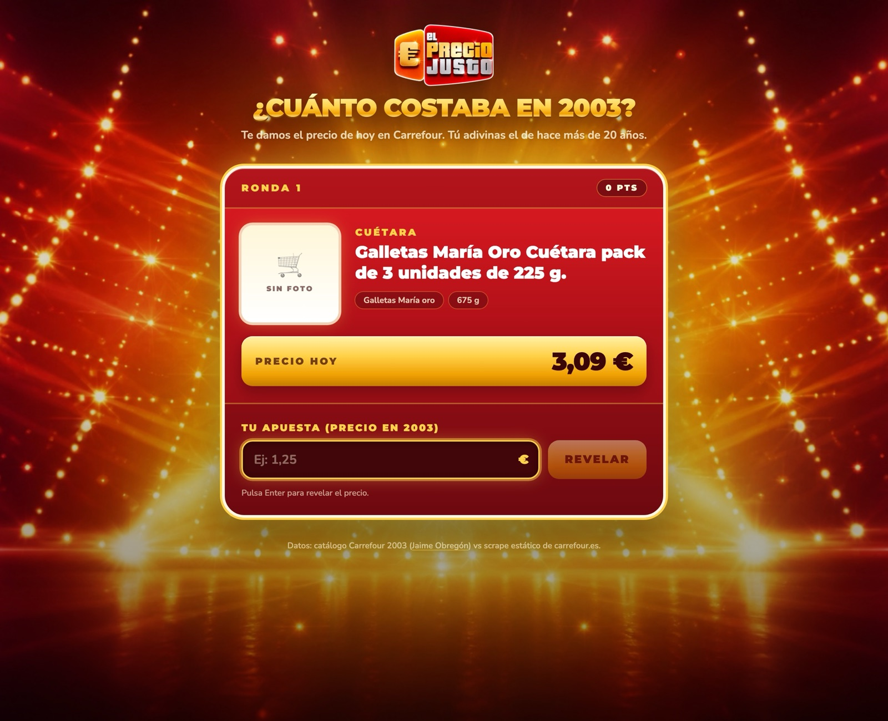
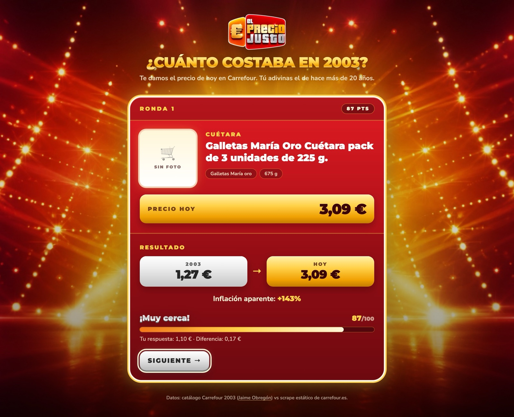
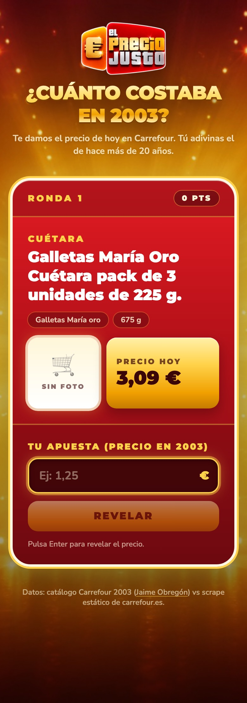
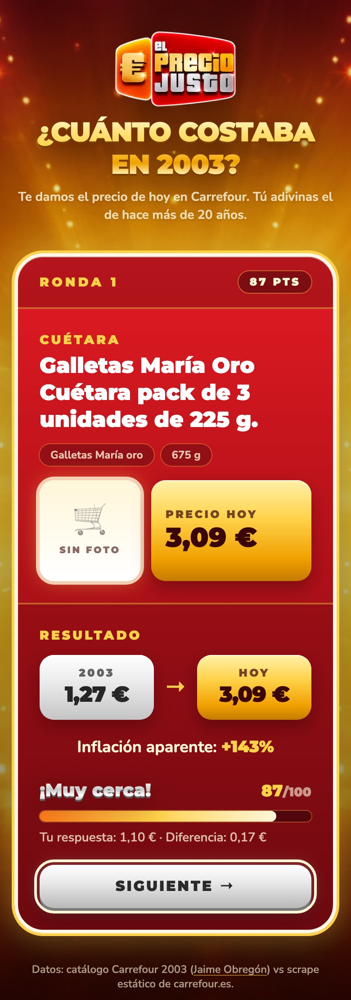

<div align="center">


# Inflación Carrefour 🛒📈

**¿Cuánto costaba en 2003?**

Te enseñamos un producto de Carrefour con su **precio de hoy** y tienes que adivinar cuánto costaba en **2003**.


</div>

## Capturas

<table>
  <tr>
    <th>Adivina el precio</th>
    <th>Resultado</th>
  </tr>
  <tr>
    <td></td>
    <td></td>
  </tr>
</table>

<p align="center">
  
  &nbsp;&nbsp;
  
</p>

## Cómo se juega

1. Ves un producto actual de Carrefour con su **precio de hoy**.
2. Escribes cuánto crees que costaba en **2003** y pulsas **Revelar** (o Enter).
3. Te mostramos el precio real, la inflación aparente y tu puntuación (0–100, según lo cerca que te quedes).
4. **Siguiente** y a por otra ronda; los puntos se van sumando.

## Qué hay aquí

- `data/products-2003.json` — catálogo histórico transformado desde el CSV de Jaime Obregón.
- `data/products-current.json` — scrape estático del catálogo online de Carrefour España.
- `data/matched-products.json` — productos emparejados listos para el juego (7.502 matches; el juego usa los de confianza ≥ 0,5).
- `scripts/` — transformación, scraping y matching reproducibles.

## De dónde salen los datos

### Precios 2003
Fuente: [carrefour.csv](https://github.com/JaimeObregon/precios/blob/main/carrefour.csv)

Campos originales: categoría, marca, formato/tamaño y precio en euros (con coma decimal).

### Precios actuales
Scrape del API público que usa la web de Carrefour España (`search-api/query/v1/search`), ejecutado con Playwright para pasar Cloudflare.

El script:
1. Arranca una sesión de navegador en `carrefour.es/supermercado/`.
2. Recorre categorías del supermercado y extrae productos embebidos en la página.
3. Lanza búsquedas por marcas y categorías frecuentes del catálogo de 2003.
4. Guarda JSON procesado + muestras raw en `data/raw/`.

> [!NOTE]
> - Los precios dependen de la tienda asignada (`store=005290`, Madrid).
> - Cloudflare puede bloquear peticiones directas con `curl`; por eso usamos navegador real.
> - No hay API oficial pública; esto es un scrape respetuoso (concurrencia baja y pausas).

## Cómo emparejamos productos

Reglas principales:
- Match por **marca + similitud de nombre/categoría**.
- Si el tamaño no coincide exactamente, elegimos el **más cercano**.
- Si hay empate simétrico arriba/abajo, nos quedamos con el **formato más pequeño**.
- Cuando cambia el tamaño, mostramos un aviso en español, por ejemplo: `20% menos cantidad, 50% más caro (ajustado por tamaño)`.

Campos útiles en el JSON final:
- `price2003`, `priceToday`
- `size2003Formatted`, `sizeTodayFormatted`
- `sizeDeltaPercent`, `priceDeltaPercent`, `inflationPercent`
- `sizeCaveat`, `matchConfidence`

## Ejecutar el juego

```bash
npm install
npx playwright install chromium

# Generar datos (puede tardar varios minutos)
npm run data:all

# Jugar
npm run dev
```

Abre la URL que imprime Vite (normalmente `http://localhost:5173`).

## Re-ejecutar solo una parte

```bash
npm run data:2003     # CSV -> JSON 2003
npm run data:scrape   # scrape Carrefour actual
npm run data:match    # emparejar catálogos
```

## Limitaciones conocidas

- Catálogo 2003: **11.215** productos.
- Scrape actual: **4.595** productos únicos (agosto 2026, tienda 005290).
- Matches generados: **7.502**; el juego filtra a **1.578** con confianza ≥ 0,5.
- Muchos productos de 2003 ya no existen o cambiaron de nombre/formato.
- Algunos matches son aproximados; mira `matchConfidence`.
- Imágenes: faltan en productos sacados de impresiones de categoría, y el CDN de Carrefour puede bloquearlas (Cloudflare). En ese caso el juego muestra un marcador «Sin foto».
- El scrape no cubre el 100% del supermercado, pero sí lo suficiente para un juego divertido.

## Stack

- Vite + React + TypeScript + Tailwind CSS
- Playwright + TSX para scripts de datos

## Créditos

- Datos 2003: [Jaime Obregón / precios](https://github.com/JaimeObregon/precios)
- Precios actuales: catálogo online de [Carrefour España](https://www.carrefour.es/supermercado/)
